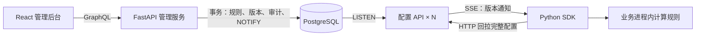

# FlagFlow

[](https://github.com/Album-dreamers/flagflow/actions/workflows/test.yaml)

功能开关与灰度发布服务：在管理后台修改规则，业务服务通过 Python SDK 接收配置，并在本地按用户计算结果。可以逐步发布新功能，也可以把一组 Prompt 与模型配置作为一个版本，按比例切换和回滚。

基于 [evo-company/featureflags](https://github.com/evo-company/featureflags) 及其 [Python SDK](https://github.com/evo-company/featureflags-py) 改造，保留完整上游历史。技术栈：FastAPI、PostgreSQL、React、Python SDK。

## 能做什么

- **按用户灰度**：以开关或功能值名称为种子，分 10,000 个桶，支持小数百分比；扩大比例时保留已经命中的用户。
- **动态更新配置**：SSE 通知客户端回拉最新规则，保留轮询兜底；规则在业务进程内计算。
- **处理并发修改**：规则、项目版本和审计日志在同一事务内写入；服务端拒绝基于旧版本的保存，管理后台提示冲突。
- **故障后恢复**：连接重试采用指数退避和随机抖动，重连后补对版本；可选本地快照支持服务不可达时的冷启动。

## 本地运行

需要 Docker（含 Compose v2）与 Node.js 18+。从仓库根目录执行：

```bash
cd server
export BUILD_VERSION=dev

docker build --target dev -t featureflags-server-dev .
docker compose up -d --wait postgres
docker compose run --rm backend python3 -m featureflags alembic -- upgrade head
(cd ui && npm ci && npm run build -- --outDir ../featureflags/web/static)
docker compose up -d web http
```

| 入口 | 地址 |
|---|---|
| 管理后台 | <http://localhost:8080> |
| SDK 配置 API 与 SSE | <http://localhost:8081> |

本地配置启用了 `test_environ`，任意用户名和密码都能登录。正式部署需关闭该选项，并配置 LDAP 或 OIDC。SDK 应连接 8081 端口。

停止服务：在 `server/` 执行 `docker compose down`；加 `-v` 会同时删除本地数据库卷。

## 演示：Prompt 与模型一起灰度

另开终端，在仓库根目录运行（需要 [uv](https://docs.astral.sh/uv/)）：

```bash
uv run --no-project --with "./sdk[httpx]" sdk/examples/http/prompt_rollout.py
```

示例注册项目 `llm-demo`，用功能值 `LLM_VARIANT` 在两组 Prompt 模板和模型之间切换，持续显示 2,000 个模拟用户的分配。它打印待发送的请求内容，无需调用模型 API。

在管理后台打开 `llm-demo` → Values → `LLM_VARIANT`：

1. 添加条件 `user.id` → `percent` → `10`，条件值填 `v2`；打开开关，点击 apply。
2. 把比例改为 `50`，再次 apply；已经分配到 v2 的用户会保留。
3. 关闭开关并 apply，全部回到默认的 v1。

从全新克隆启动后实际运行的输出（每次 apply 后不到 1 秒打印一行；user 1 落在前 10%，可以看到它的模型和 Prompt 一起切换）：

```text
v1: 100.0% | user 1 -> {'model': 'small-model', 'prompt': 'Answer the question: 2+2?'}
v1: 89.6%, v2: 10.4% | user 1 -> {'model': 'large-model', 'prompt': 'Think step by step, then answer briefly: 2+2?'}
v1: 49.2%, v2: 50.8% (kept v2: 208 of 208) | user 1 -> {'model': 'large-model', 'prompt': 'Think step by step, then answer briefly: 2+2?'}
v1: 100.0% (kept v2: 0 of 1016) | user 1 -> {'model': 'small-model', 'prompt': 'Answer the question: 2+2?'}
```

Prompt 与模型通过一个值一起选择，避免两次独立分桶导致组合错配；未知版本会记录警告并回退到 v1。实现见 [prompt_rollout.py](sdk/examples/http/prompt_rollout.py)。

## 工作方式



主库模式下，每个配置 API 实例用一条专用连接监听 PostgreSQL，再向本实例的客户端分发版本通知；只读副本模式改用轮询。SDK 收到通知后回拉，断线重连、服务端周期补对及客户端轮询负责恢复遗漏的通知。

目标是**收敛到最新配置**。慢客户端可以跳过中间版本，SSE 不承担历史变更逐条投递的职责。

## 相对上游的主要改造

| 改造 | 解决的问题 |
|---|---|
| 开关名参与哈希，10,000 桶 | 不同开关选中同一批用户，百分比被截成整数 |
| 单事务、行级乐观锁、mutation 独立记录 | 修改一半失败、过期保存被静默丢弃、审计记录串入其他修改 |
| SSE + LISTEN/NOTIFY，重连补对版本 | 仅依赖轮询；多实例和监听连接重启后恢复通知 |
| SDK 整份更新、版本单调前进、原子快照 | 配置被旧响应覆盖、编译失败留下半更新状态、离线启动丢失规则 |
| 合并并发读取、按版本缓存、批量注册与时间戳节流 | 集中建连和集中启动时耗尽连接池；同时回拉时每个请求都重新组装整个项目 |
| 新增实体时推进版本、拒绝非法正则 | 实例间缓存不一致、错误规则进入客户端 |

实现细节、组件来源、方案取舍和其他修复见 [设计与实现](docs/engineering.md)。

## 实测结果

条件：阿里云 **4 vCPU / 7 GB**，压测端、服务端和 PostgreSQL 在同一台机器；项目有 20 个开关。下表单实例测试使用一个 uvicorn 进程，延迟包含压测端处理开销。

| 测试 | 结果 |
|---|---|
| 10,000 条 SSE 连接，仅接收事件 | 100,000 次投递全部送达；事件延迟 P99 **4.16 s**，服务 RSS **656 MB**（修复前只有 4,416 个客户端收到过推送） |
| 1,000 个客户端收到事件后回拉 | 全部追到最终版本；提交到回拉完成 P99 **5.10 s**（加缓存前 0 个追上，P99 35.2 s） |
| 1,000 个客户端以 50/s 启动，连接池 10 | `/flags/load` 零失败，平均 **0.45 s**；全部追到最终版本（修复前失败率 89.2%） |
| PostgreSQL 重启，300 个客户端 | 2,100 次投递全部送达，回拉零失败；在 Hub 重连前提交的版本没有人收到 NOTIFY，靠重连后的补对送达 |
| 两个配置 API 实例，各 500 个客户端 | 5,000 次投递全部送达；事件延迟 P99 **0.80 s** |

万连接测试没有执行逐客户端回拉。连接池 40 的启动测试中有 40 次（0.8%）回拉失败，客户端在下一次事件补拉后全部追上；完整条件和局限见 [压测与故障验证](docs/benchmarks.md)。

[原始数据与运行命令](server/loadtest/results/README.md) 已归档，可重新统计：

```bash
python server/loadtest/report.py server/loadtest/results/fanout-10000-after --users 10000
```

## 测试与开发

服务端测试（需要 [lets](https://lets-cli.org/) 和 Docker）：

```bash
(cd server && lets test)
```

SDK 测试（Python 3.9+，建议使用虚拟环境）：

```bash
cd sdk
python -m pip install -e ".[httpx,aiohttp,requests]" "pytest~=7.1" "pytest-asyncio~=0.18" "faker==18.13"
python -m pytest featureflags_client/tests
```

[CI](https://github.com/Album-dreamers/flagflow/actions/workflows/test.yaml) 包含前端构建、服务端 Docker 测试，以及 SDK 的 Python 3.9–3.13 矩阵。开发命令见 [server/lets.yaml](server/lets.yaml)，SDK 选项见 [SDK README](sdk/README.md)，压测用法见 [loadtest](server/loadtest/README.md)。

## 来源与许可证

| 目录 | 上游起点 |
|---|---|
| `server/` | evo-company/featureflags v2.0.0，`7294474` |
| `sdk/` | evo-company/featureflags-py 0.7.0，`2f36373` |

上游历史保留在仓库内，可用 `git log --author=Album-dreamers` 查看本项目提交。SSE、缓存和哈希所用组件及来源见 [设计与实现](docs/engineering.md)。

MIT，保留原作者版权声明：[服务端 LICENSE](server/LICENSE)、[SDK LICENSE](sdk/LICENSE)。
