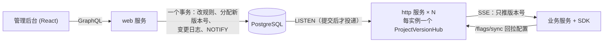

# 设计与实现

本页记录对上游的改造、组件选择和已验证的问题，使用入口见 [项目首页](../README.md)。

## 架构

- 写入端：保存开关时，规则、项目版本号、变更日志和 `pg_notify` 在同一个事务里，事务回滚就不会发出通知。
- 推送：主库模式下，每个 http 实例用一条连接 `LISTEN`，按项目唤醒本实例上的 SSE 连接。只读副本模式改用轮询。事件只带版本号，客户端再用 `/flags/sync` 拉配置（通知 + 回拉）。
- 断线后收敛到最新配置：
  1. 客户端连上时带着自己的版本号，如果落后，服务端立即补发；
  2. 监听连接断开后指数退避重连，重连后先按表里的版本补对一遍；
  3. 每 30 秒再对一次，同时用 `SELECT 1` 探测半开连接；
  4. 原有的轮询保留作兜底。

## 对上游的主要改造

**1. 灰度放量的哈希里没有开关名**（`sdk/`，提交 `7d1c659`）

原来是 `md5(变量名 + 值) % 100`，所有用同一变量的开关都选中同一批用户，两个各放 50% 的开关有 49.84% 的用户重合，而且最细只能放 1%（0.5% 时一个用户都选不中）。改为 GrowthBook 的 gbhash v2，以开关名为种子、分 10000 个桶，并用 GrowthBook 的 v2 测试向量校验。

**2. 修改开关不在一个事务里**（`server/`，`153e775`）

aiopg 默认自动提交，改规则、版本号加一、写变更日志是分开提交的。测试复现出三种情况：

- 版本号加一失败：规则改了，客户端却永远同步不到；
- 写日志失败：审计记录缺失；
- 两个管理员基于同一个旧页面修改：后保存的人的条件被唯一约束和 `ON CONFLICT DO NOTHING` 静默丢弃，接口却返回成功，日志里还多一条虚假记录。

改为单事务，并给 `flag`、`value` 表加行级 `version` 列做乐观锁；拿旧版本保存会被拒绝。管理后台已经在浏览器里验证过（两个标签页修改同一个开关）。

后来又修了两处同类问题：同一个 GraphQL 请求里的多个修改原来共用一份变更记录，被拒绝的保存会被后面的保存一起写进审计日志，第二次保存还会被误判为冲突；现在每个修改各自记录。删除项目原来也不在事务里，中途失败会留下一个没有开关的空项目，现在放进了一个事务。

**3. 轮询改为推送**（`server/` `c22d429`，`sdk/` `cc9ca1f`）

原来 SDK 只能轮询 `/sync`，并且只要版本号不同就下发整个项目的配置。现在服务端新增 `GET /flags/stream`（SSE），SDK 加了 `HttpxManager(stream=True)`：断线后指数退避加 jitter 重连，重连时带上当前版本号，原有轮询保留作兜底。删除开关不加版本号这个上游 bug 也一起修了，否则客户端会一直执行已删除开关的规则。

**4. SDK 的健壮性**（`sdk/` `03f5676`、`376d4ed`）

- 只接受更大的版本号。原来用 `!=` 比较，迟到的旧响应会把配置回滚。
- 本地快照：每次版本前进后原子写入（同目录临时文件 + `fsync` + `os.replace`）；启动时连不上服务端，就用快照里的真实规则，而不是代码里写死的默认值。
- 断线退避：连接稳定 60 秒以上才重置退避间隔。原来每次连上就重置，如果服务端接受连接后立刻断开，客户端会一直按最短间隔重连。
- 项目删除后重建：项目版本号改由一个全局序列生成（服务端改动），重建的项目会从比旧版本更大的号开始。原来重建后从 0 开始，SDK、快照和 SSE Hub 都只接受更大的版本，会一直拒绝新配置。

**5. 压测中发现的三个扩展性问题**（`server/` `cfdd533`、`1194bc3` 等）

- 每条新的 SSE 连接都查一次数据库：1 万个连接涌入时打满了 10 个连接的连接池，56% 的客户端一次推送都没收到。改为由 Hub 在内存里维护版本号，同一项目的并发查询合并成一次；只在监听连接正常时信任内存里的值，重连时清空。
- 回拉惊群：所有客户端在同一时刻回拉同一个版本，每次都要重新组装整个项目，1000 个客户端时一轮回拉要 35 秒。改为按（项目，版本）缓存组装结果，同时到达的请求共用一次计算（async-lru）。
- 集中启动时 `/flags/load` 大量失败：每次加载都要对每个开关单独查询一次，再 `UPDATE` 一次 `reported_timestamp`。同时启动的客户端都在更新同一批行，只能互相排队，每个请求占着连接的时间被拉长，最后在连接池上排队超时。改为每类实体一条查询批量注册；"最近上报时间"同一行 1 分钟内最多写一次。已有实体的一次加载从约 40 条查询降到 5 条，不随开关数量增长；新增实体还需插入并推进版本。结果见 [压测与故障验证](benchmarks.md)。数据库连接池大小也做成了可配置项（`postgres.pool_maxsize`）。

**6. 管理后台与其他修复**

- 未登录时打开管理后台是白屏（`9161e50`）：上游 `Base.jsx` 在部分 Hook 之前就提前 return 了（React #300），从 2024 年起一直存在。
- 首页返回 500（`84006dc`）：升级 Starlette 1.x 时引入的回归。原有测试没有覆盖首页，已补上测试。
- 新开关、新值的创建时间都是服务启动的时刻：上游模型里写的是 `default=datetime.utcnow()`，时间在模块导入时就固定了。

## 用到的现成组件

| 用途 | 组件 |
|---|---|
| SSE 响应、保活、关停时结束流 | [sse-starlette](https://github.com/sysid/sse-starlette)（BSD-3） |
| 多实例转发 | PostgreSQL LISTEN/NOTIFY（通过 aiopg） |
| 放量哈希 | GrowthBook gbhash v2（MIT，移植） |
| 按版本缓存、合并并发请求 | [async-lru](https://github.com/aio-libs/async-lru)（MIT） |
| SDK 解析 SSE | [httpx-sse](https://github.com/florimondmanca/httpx-sse)（MIT） |
| 压测 | [locust](https://locust.io) |

比较过但没有采用的候选（都下载源码核实过）：

| 候选 | 没采用的原因 |
|---|---|
| FastAPI 自带的 `fastapi.sse` | 服务关停时要等超时，然后每条连接打一段异常堆栈 |
| aiopg-listen | 没有保活，连接半开时永远收不到通知；2023 年后没再发版 |
| asyncpg-listen | 要多引一个数据库驱动；和 aiopg-listen 一样，都不通知"已重连"，丢失的通知要等空闲窗口才补 |
| launchdarkly-eventsource | 异步客户端在文档里标为 experimental；要求 Python ≥ 3.10，而 SDK 支持 3.9 |
| Unleash FileCache（fcache） | 临时文件建在系统临时目录，跨文件系统时退化成非原子的复制 |
| atomicwrites | 已停止维护，作者建议直接用 `os.replace` |

## 配置一致性与输入校验

- 新注册开关或功能值时，插入、项目版本推进和 NOTIFY 在同一事务中完成；已有实体的重复上报不推进版本。这让其他实例的缓存和已经启动的 SDK 都能看到新增配置。
- SDK 先编译全部开关和功能值，再统一替换状态和版本号。编译失败时保留原有状态；遇到历史数据中的非法正则时，该条检查不匹配并记录警告。
- 管理接口拒绝保存非法正则，前端显示保存成功、版本冲突及输入错误，失败的保存不留下部分写入。
- 每个 GraphQL mutation 使用独立的变更跟踪，避免同一请求中的修改互相影响。
- 升级 Starlette 后，Prometheus 中间件也已升级并补充回归测试；SSE 的请求时延计到响应开始，不把长连接持续时间当成普通接口时延。

## 同步语义与边界

SSE 用来提醒客户端回拉，最终配置以数据库和 `/flags/sync` 为准。慢客户端可能跳过中间版本，重连、版本补对和轮询负责收敛到最新状态；系统不提供每一个历史版本的可靠逐条投递。

配置仍按项目全量回拉。SSE 由 `HttpxManager(stream=True)` 启用；requests 和 aiohttp manager 使用轮询。本地快照需要显式设置 `snapshot_path`。

仅 Python SDK 改用了新的灰度哈希；接入其他语言 SDK 时，需要同步算法才能获得一致分组。

返回 [项目首页](../README.md)。完整性能数据见 [压测与故障验证](benchmarks.md)。
